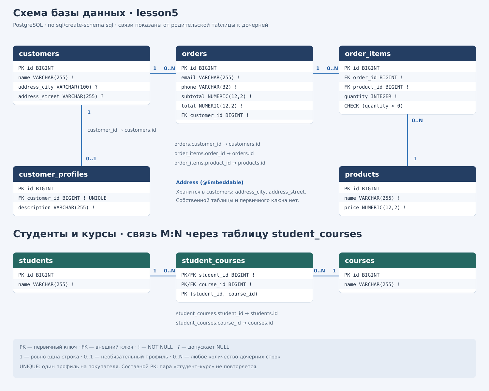

# Lesson 5 — JPA Relationships / Связи между сущностями

## Схема базы данных



[Открыть схему в SVG](database-schema.svg). Поля и ограничения соответствуют
[sql/create-schema.sql](sql/create-schema.sql).


Отдельный учебный модуль `order-relationships` для пятой лекции.
Сохраняем пакеты, assigned id, Spring Boot 4.1.1 и ручной JPA API предыдущего
урока, но здесь выполняются только опыты с отношениями. Код Lesson 4 остаётся
в прежнем модуле. Сервисы, уведомления и эксперименты жизненного цикла сюда
не перенесены: каждый запуск показывает один пример пятой лекции.

Основной вопрос: как ссылки между Java-объектами представлены внешними ключами
и таблицами связей в PostgreSQL? Все опыты находятся в `demo`. Используем `EntityManagerFactory`, `EntityManager`, `EntityTransaction`;
в каждом опыте видны `begin`, `commit`, обработка ошибки через `rollback` и закрытие.

### Сначала схема, затем Java

Из каталога `order-relationships`:

```bash
docker compose up -d
# Создаём все восемь таблиц в отдельной schema lesson5:
docker compose exec -T postgres psql -v ON_ERROR_STOP=1 -U student -d orders < sql/create-schema.sql
# Проверяем реальные FK и UNIQUE, а не только аннотации:
docker compose exec -T postgres psql -v ON_ERROR_STOP=1 -U student -d orders < sql/verify-relationships.sql
```

Compose использует прежние PostgreSQL 18, контейнер `orders-postgres`, порт 5432,
volume и БД `orders`, пользователя и пароль `student`. Новый модуль подключается
с `currentSchema=lesson5`. SQL вручную создаёт изолированную schema и допускает
повторное выполнение. Старые таблицы в `public` не используются и не изменяются.
Не удаляйте общий volume для перезапуска лекции.
`ddl-auto=validate` и `spring.sql.init.mode=never` сохранены: Hibernate ничего не
создаёт. Проверка Hibernate не заменяет проверку физических FK и UNIQUE;
`verify-relationships.sql` выдаёт ошибку, если нужных ограничений нет.

| Таблица | Что хранится |
|---|---|
| `customers` | `id`, `name`, `address_city`, `address_street` |
| `orders` | прежние колонки + `customer_id → customers.id` |
| `products` | `id`, `name`, `price NUMERIC(12,2)` |
| `order_items` | `id`, `order_id → orders.id`, `product_id → products.id`, `quantity` |
| `customer_profiles` | `id`, `customer_id → customers.id` с UNIQUE, `description` |
| `students`, `courses` | собственные `id`, `name` |
| `student_courses` | `student_id → students.id`, `course_id → courses.id`, составной PK |

Внешний ключ (Foreign Key, FK) — колонка со ссылкой на ключ другой таблицы.
База проверяет, что ссылка ведёт к существующей строке. Кардинальность показывает,
сколько объектов может участвовать в связи: один покупатель — много заказов;
один заказ — много позиций; каждая позиция — один товар.

`orders.customer_id` обязателен: `@ManyToOne(optional=false)` и
`@JoinColumn(nullable=false)` соответствуют `BIGINT NOT NULL REFERENCES customers(id)`.
Новый заказ получает покупателя до persist. В `order_items` оба FK обязательны;
профиль тоже обязан ссылаться на покупателя. Типы ключей — BIGINT, id задаются
вручную. Схема отдельная, поэтому прежние заказы и эксперименты Lesson 4 не
накладывают ограничений на новый учебный пример.

### От FK к двусторонней связи

`OrderEntity.customer` с `@ManyToOne` и `@JoinColumn(name="customer_id")`
представляет `orders.customer_id`. `order.getCustomer()` — Java-навигация по той
же связи. Ссылка не сохраняется как произвольный Java-объект в колонке:
Hibernate записывает идентификатор покупателя.

`CustomerEntity.orders` с `@OneToMany(mappedBy="customer")` позволяет идти в
обратную сторону. **Owning side — владеющая сторона** — `OrderEntity.customer`:
именно она содержит `@JoinColumn` и определяет значение FK. Коллекция покупателя —
обратная сторона. `mappedBy="customer"` указывает **имя Java-поля**, а не
`customer_id`, которое является именем SQL-колонки. Дополнительная таблица для
этой обратной коллекции не нужна.

Двусторонняя связь представлена дважды в памяти: `Customer.orders` и
`Order.customer`. Hibernate не синхронизирует произвольные изменения этих
Java-ссылок. В `owning-side` добавляем заказ A только в коллекцию B: в памяти
получаем противоречие, однако FK остаётся 501. В следующей транзакции меняем
`order.setCustomer(B)`: FK становится 502. Это корректные строки с существующими
покупателями, а не попытка нарушить ограничение БД.

Методы-помощники `Customer.addOrder/removeOrder` согласуют обе стороны.
`addOrder` также удаляет заказ из коллекции прежнего покупателя и не добавляет
дубликат. Последняя фаза `owning-side` переносит заказ обратно к A через помощник
и проверяет обе коллекции и ссылку. `removeOrder(order, newCustomer)` требует другого покупателя и переносит заказ
через его `addOrder`. Обнулять ссылку здесь нельзя: FK обязательный. Попытка
`setCustomer(null)` отклоняется; вместо временно недопустимого состояния меняем
ссылку сразу на нового покупателя.
Обычный `setCustomer` оставлен для явного показа владеющей стороны; он сам не
согласует коллекции.

### Позиция заказа, каскад и удаление дочерней сущности

```text
Customer 1 ── * Order 1 ── * OrderItem * ── 1 Product
```

У `OrderItem` два `@ManyToOne`, внешние ключи `order_id` и `product_id`, а также
собственное `quantity`. Поэтому связь заказа с товаром стала отдельной сущностью.
Чистая `Order ↔ Product @ManyToMany` хранила бы только два ключа и не выражала бы
количество. Если у самой связи есть данные, часто нужна **сущность связи
(Link Entity)**. Позже такими данными могли бы быть цена покупки или скидка;
здесь достаточно количества.

**Cascade — распространение операции JPA на связанные сущности**, а не «сохранить
всё автоматически». `PERSIST`: `persist(parent) → persist(child)`;
`REMOVE`: `remove(parent) → remove(child)`. `CascadeType.ALL` включает все
каскадируемые операции, поэтому ставить его на каждую ссылку нельзя.
У `Order.items` выбран ALL: позиция принадлежит жизненному циклу заказа.
У `OrderItem.product` каскада нет: товар существует независимо. Удаление заказа
или его позиции не должно удалить товар из каталога. У `Customer.orders`
каскада удаления также нет.

В `cascade-persist` товар уже существует. Создаём заказ и позицию, согласуем
`Order.items` и `OrderItem.order` через `addItem`, затем вызываем **только**
`em.persist(order)`. INSERT позиции возникает из распространения PERSIST.
INSERT товара в основной фазе нет; INSERT/UPSERT подготовки не надо путать с опытом.

**orphanRemoval — удаление дочерней сущности, утратившей связь с родителем.**
При `order.removeItem(item)` помощник удаляет позицию из коллекции и обнуляет
обратную Java-ссылку. Для managed позиции этого заказа Hibernate при синхронизации
выполняет DELETE, а не UPDATE обязательного `order_id` на NULL. Удалённую позицию
нельзя отдельно сохранять или переносить в другой заказ: создайте новую позицию.
`addItem` отклоняет перенос позиции, уже принадлежащей другому заказу.

Различайте два события:

* Cascade REMOVE: удаляем родителя → операция удаления распространяется на детей.
* orphanRemoval: убираем ребёнка из связи с родителем → ребёнок становится
  «сиротой» → DELETE ребёнка; сам родитель остаётся.

В опыте `orphan-removal` начальные две позиции подготовлены отдельной транзакцией.
Удаляем одну через помощник без `em.remove(order)`, после commit новым контекстом
проверяем отсутствие 801, наличие 802, заказа и товара.

### Один к одному, многие ко многим, встроенное значение

`CustomerProfileEntity.customer` — простой однонаправленный `@OneToOne`.
Профиль владеет `customer_profiles.customer_id`. Обычный FK проверяет существование
покупателя; **UNIQUE** запрещает два профиля одного покупателя. Покупатель может
не иметь профиля. Отдельный SQL и интеграционный тест проверяют UNIQUE физически.

`StudentEntity.courses` — однонаправленный `@ManyToMany` с `@JoinTable`.
Один студент может посещать несколько курсов, один курс — иметь нескольких
студентов. **Join table — таблица связей** `student_courses` содержит пары ключей.
Коллекция не записывается в одну колонку. Составной PK исключает повторную пару.
Студент владеет связью; курсы независимы, каскада удаления нет.

`Address` помечен `@Embeddable`, а `Customer.address` — `@Embedded`.
**Embeddable — встраиваемое значение**: адрес является частью состояния покупателя,
не имеет собственного persistent id и самостоятельного жизненного цикла сущности.
В отличие от `@Entity`, ему не нужна таблица. `@Column` в Address явно задаёт
`address_city/address_street`; переопределения колонок здесь не требуются.
Меняем Address → UPDATE строки покупателя, без INSERT в отдельную таблицу адресов.

### Выбор одного опыта

Свойство `app.demo.relationship-experiment` выбирает один метод runner.
Пустое или неизвестное значение выводит список и не меняет данные:
подготовка запускается только внутри выбранного опыта. При этом подключение и
проверка схемы всё равно выполняются. Свойства `app.demo.persistence-experiment`
здесь нет, а старый runner отсутствует: за один запуск выполняется ровно один
опыт отношений.

```bash
mvn spring-boot:run
mvn spring-boot:run -Dspring-boot.run.arguments=--app.demo.relationship-experiment=many-to-one
mvn spring-boot:run -Dspring-boot.run.arguments=--app.demo.relationship-experiment=owning-side
mvn spring-boot:run -Dspring-boot.run.arguments=--app.demo.relationship-experiment=cascade-persist
mvn spring-boot:run -Dspring-boot.run.arguments=--app.demo.relationship-experiment=orphan-removal
mvn spring-boot:run -Dspring-boot.run.arguments=--app.demo.relationship-experiment=one-to-one
mvn spring-boot:run -Dspring-boot.run.arguments=--app.demo.relationship-experiment=many-to-many
mvn spring-boot:run -Dspring-boot.run.arguments=--app.demo.relationship-experiment=embeddable
```

Для Lesson 4 запускайте отдельный прежний модуль `order-persistence-context`.
Не запускайте опыты и интеграционные тесты параллельно.

Зарезервированы покупатели 501/502, заказ 601, товар 701, позиции 801/802,
профиль 901, студент 1001 и курс 1101. Подготовка очищает учебный заказ вместе с
его позициями, профиль 901 и связи студента 1001, восстанавливает покупателей и
товар. Эти id принадлежат опытам; не используйте их для других данных.
Другие строки schema lesson5 не затрагиваются. Каждый новый запуск восстанавливает
исходное состояние; чистая БД не требуется. Фаза PREPARE коммитится отдельно.

### Что видеть в SQL

Сначала найдите маркер опыта, затем PREPARE, основной CHANGE/PERSIST,
FLUSH / COMMIT и VERIFY DATABASE. SQL подготовки не является результатом опыта.
Проверки используют новый EntityManager; `PASS` печатается только при успехе.
Сохранены SQL и TRACE только параметров, без общего Hibernate DEBUG.

| Значение | Ожидаемое изменение | Фактически проверенный SQL основной фазы |
|---|---|---|
| `many-to-one` | Java-ссылка → FK | SELECT покупателя; `insert into orders (customer_id,email,phone,subtotal,total,id) values (?,?,?,?,?,?)`, FK 501 |
| `owning-side` | FK определяет Order.customer | Только коллекция B: без UPDATE; setCustomer(B): UPDATE с FK 502; addOrder(A): UPDATE с FK 501 |
| `cascade-persist` | persist заказа распространяется на позицию | INSERT orders; `insert into order_items (order_id,product_id,quantity,id) values (?,?,?,?)`; без INSERT products |
| `orphan-removal` | Удаление связи с ребёнком удаляет его | `delete from order_items where id=?`, id 801; без UPDATE order_id на NULL |
| `one-to-one` | FK + UNIQUE | `insert into customer_profiles (customer_id,description,id) values (?,?,?)`, FK 501 |
| `many-to-many` | Коллекция → отдельная таблица | `insert into student_courses (student_id,course_id) values (?,?)`, 1001/1101 |
| `embeddable` | Встроенное значение → колонки родителя | `update customers set address_city=?,address_street=?,name=? where id=?` |

Hibernate 7.4.5.Final обновляет в `orders` не только FK, но и остальные отображённые
поля: `update orders set customer_id=?,email=?,phone=?,subtotal=?,total=? where id=?`.
Это реальное поведение данного запуска; изменение одной ссылки не означает,
что UPDATE содержит только одну колонку. SELECT при загрузке и проверке также
виден в логах; число SELECT не является предметом этого урока.

### Проверка

```bash
mvn clean test
# Сначала выполните sql/create-schema.sql; требуется настоящий PostgreSQL:
mvn clean test -Drelationships.integration=true
# Семь отдельных запусков с отдельными SQL-логами:
bash scripts/verify-relationships.sh
```

Обычная сборка выполняет два теста помощников и пропускает девять PostgreSQL
тестов, если флаг не указан. Интеграционные тесты используют конфигурацию модуля и schema lesson5,
не создают схему и не подменяют БД. Они проверяют семь опытов, каскад удаления
заказа без удаления Product/Customer, а также отказ UNIQUE при втором профиле.
Попытка второго профиля выполняется внутри откатываемой транзакции.

Семантика сверена с [официальной спецификацией Jakarta Persistence 3.2](https://jakarta.ee/specifications/persistence/3.2/jakarta-persistence-spec-3.2).


Проверка отдельного модуля 2026-10-09: `mvn clean test` — BUILD SUCCESS;
с `-Drelationships.integration=true` все 11 тестов прошли. Все семь опытов
запущены отдельно два раза на PostgreSQL 18. Фактический SQL подтверждён.
Режимы справки и неизвестного значения не меняют данные. Снимки старой schema
`public` до и после совпадают. Подробный состав файлов и результаты — в [REPORT.md](REPORT.md).
